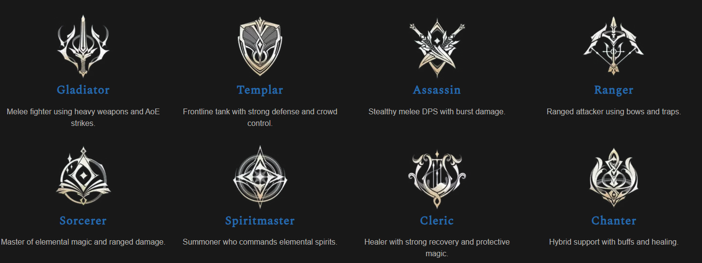
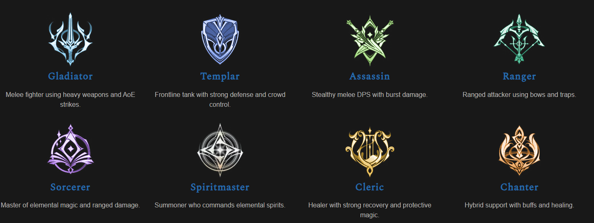

# Classes and their icons

The game sometimes shows only a class icon (party lists, nameplates). Icons and one-line roles from a guide
site, shared by the user 2026-10-16; the in-game icons look the same (in-game 2026-10-17).

Top row left to right: Gladiator, Templar, Assassin, Ranger. Bottom row: Sorcerer, Spiritmaster, Cleric, Chanter.

In-game the icons are colored per class, on a dark diamond frame (party list, Battlefield lineup, Expedition room list, in-game 2026-10-20). All 8 colors seen.
Colored copy: `images/class-icons-color.png` (tint approximated by eye); regenerate with
`node knowledge/images/tint-class-icons.js` after changing a color there.

| Class | Role | How to spot the icon | In-game color |
|---|---|---|---|
| **Gladiator** | Melee DPS, heavy weapons, AoE | One big sword pointing down, with curved horn-like blades on both sides (trident shape) | light blue |
| **Templar** | Tank, defense, crowd control | A **shield** with a gold chevron (V) in the middle | blue |
| **Assassin** | Melee burst DPS, stealth | **Two crossed daggers** (X) with a small diamond at the crossing | light green |
| **Ranger** | Ranged DPS, bow, traps | A **bow with an arrow pointing up**, wing-like limbs | green |
| **Sorcerer** | Ranged magic DPS | A **diamond in a ring**, open book or wing shapes underneath | purple |
| **Spiritmaster** | Summoner (elemental spirits) | A **four-pointed star inside a full circle** (compass look) | pink/magenta |
| **Cleric** | Healer, protective magic | A **lyre/harp**: two curved arms with upright strings in the middle | yellow/gold |
| **Chanter** | Hybrid support, buffs + healing | A **flame/lotus** shape with a small orb, petals curling outward | orange |

Easy pairs to mix up: **Sorcerer vs Spiritmaster** (Sorcerer has the book underneath, Spiritmaster is a star
in a full circle) and **Cleric vs Chanter** (Cleric is the lyre with strings, Chanter the flame with an orb).

## Chanter as a healer (researched 2026-10-17, guides, unverified)

Short answer: **a Chanter can heal, but as an off-healer, not a Cleric replacement in hard content** [316].
Skill data from [315] (read from a global client build, no date); guide advice from [316] (2026-10-04).

- **Recuperation** (active, Lv 8): instant party heal (40m) + HoT every 2s for 8s, removes 1 debuff, 15s CD [315].
  The main off-heal; heals twice as much at Lv 16 [316].
- **Healing Touch** (Stigma): party heal, ~930–1,020 HP at Lv 1, 30s CD [315]; range 40m [315] **vs** 25m [316].
- **Sprint Mantra** (Stigma): Move Speed +10.5%; each attack has a 15% chance to heal self and party a little
  [315]; proc cooldown 1s [315] **vs** 15s [316].
- **Guardian Blessing** (Stigma): self only, +5.4% Max HP and heals 5.4% [315].
- **Shields / damage floors:** Impeding Authority (party shield 16% Max HP, 20s, 90s CD); Barrier Spell
  (party HP can't drop below 10% for 3s, not against some big attacks, 180s CD); Protection Circle passive
  → Divine Barrier for the party at 10 stacks [315][316].
- **Passives:** Blessing of Life (Max HP, Heal Boost scaling with Attack), Crossguard (small heal on Block) [315].
- **No resurrection skill** found [315].
- Weaknesses [316]: heal Stigmas take slots from damage ones (a support preset is Undefeated Mantra +
  Healing Touch + Impeding Authority + Barrier Spell); healing scales with Attack; heals need timing;
  movement-heavy fights cut attack uptime (less Sprint Mantra / Protection Circle).

### Buffs that don't stack with a Cleric's [316][315]
| Chanter | Cleric | Rule |
|---|---|---|
| Undefeated Mantra (+PvE Damage Boost / Tolerance) | Light of Protection | Damage Boost doesn't stack, higher skill level wins, Mantra wins ties [310] |
| Power of the Storm (Combat Speed +20%, cooldowns −20% self / −10% party, 40m, 120s CD) | Earth's Blessing (Earth Punishment, Double Chance) | **Mutually exclusive**: whichever is active blocks the other (both tooltips: Earth Punishment in-game 2026-10-17, Power of the Storm [315]) |
| Earth's Promise (passive, −PvE Damage Tolerance on target) | Chain of Torment (−PvE Damage Tolerance) | don't stack [316] |

## Party vs force: who your heals and buffs reach (researched 2026-10-25)

- **Force** = up to 4 parties, 24 players; the leader assigns members to parties [438] (KR community, unverified for EU).
- **Heals and buffs reach your own party only, as far as known.** The user's in-game impression (2026-10-25, not
  certain): in a force, heals seem to land only on the own party. Guides describe the group heals (Radiant Recovery,
  Light of Regeneration) as hitting "party members" [437], and a player reports not being able to heal anyone outside
  the party in the open world [436]. **No source says heals reach other parties of a force**; none says outright
  that they can't, either. To be sure: in a force, target a member of another party and cast Healing Light.
- **Exception (KR, 2026-09-22):** while an Abyss boss is up, party buff skills apply to everyone in the Abyss and
  related PvP content; buffs only, heals not mentioned [439]. Unverified for EU.
